# Flowcharts at cfff206

How each tool decides what to read and what to answer, with every call to jev marked. Thresholds are the defaults in `cli.ts` and `shelf.ts`. How each step works and why is in [searching.md](searching.md), [answers.md](answers.md) and [tables.md](tables.md); these charts are drawn from the code at commit cfff206 and are not kept up to date with it, so check a step against the code before relying on its chart.

## Overview

The three tools and the walk they share. Blue boxes are jev calls, numbered as in the table below; amber are decisions; green an answer; red an exit with none; purple a step with a chart of its own.

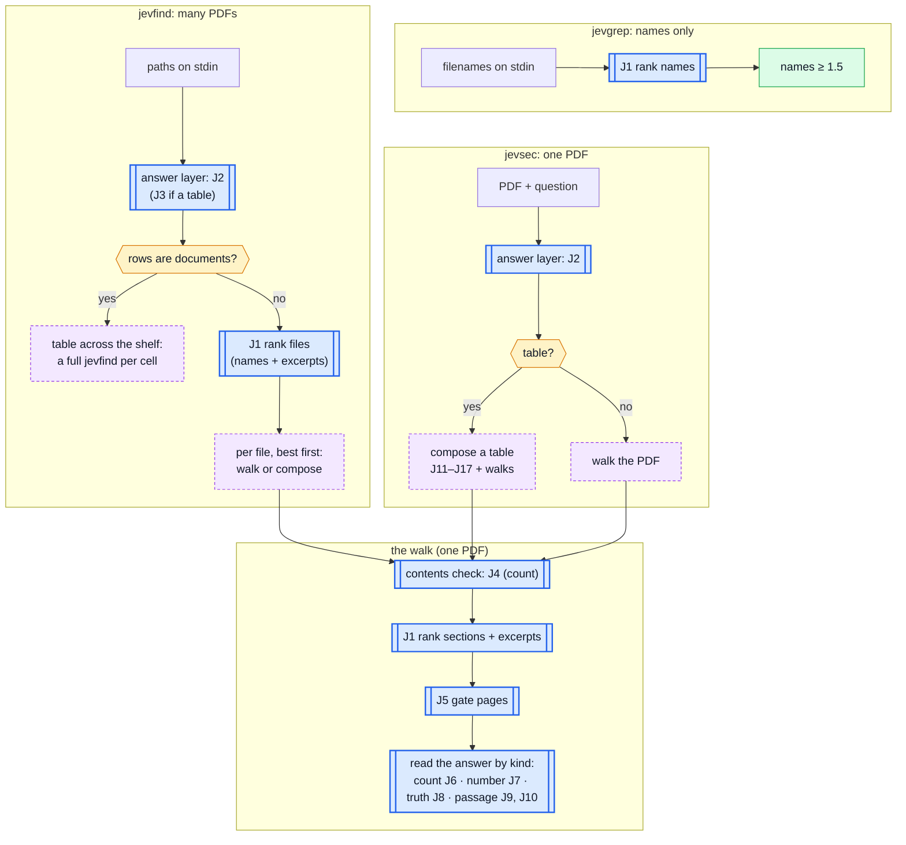

### Every jev call

| id | call | asks, in one request | where |
| --- | --- | --- | --- |
| J1 | rank (`rank`, shared.ts) | a `score` of 0–3 per item, 40 items per call, calls in parallel | filenames (jevgrep, jevfind); section titles and page excerpts (the walk) |
| J2 | read the question (`readQuestion`, answer.ts) | a `choice` of kind; a `noul` for a figure of each of several things; four `noul`s per word: quantity, counted kind, subject, game | every question, and every cell of a table across the shelf |
| J3 | read across (`readAcross`, shelf.ts) | a `noul` for rows that are documents; two `noul`s per word: row name, column question | jevfind |
| J4 | contents (`answerFromOutline`) | a `choice` of the section whose children are the things counted; a `noul` per section for children that are groups | count |
| J5 | gate (`askPages`, `askWindow`, pdf.ts) | a `noul` per page: contains the answer, lists entries of the kind, or truth's three; pages batched to `--chars` | every section and excerpt the walk reads |
| J6 | count (`rawCount`) | a `noul` per candidate name, at most 150 per call | count |
| J7 | figure (`numberFrom`) | a `choice` per quantity among the page's figures and "not stated" | number |
| J8 | claim (`growList`) | the three truth `noul`s on a neighbouring page | truth, when a list says false |
| J9 | sentences (`readPassage`) | a `noul` per sentence or table row, at most 150 per call | passage; table rows |
| J10 | columns (`columnsFor`) | a `choice` per table and quantity: the column holding it | passage naming quantities; placing a table's columns |
| J11 | request (`readRequest`, compose.ts) | a `noul` for keeping the table's own columns; three `noul`s per word: row thing, column, what to add | table |
| J12 | annotated columns (`readRequest`) | a `noul` per column for adding the value beside its items | table, when something is added |
| J13 | table (`pickTable`) | a `choice` of the table with a row per thing | table, when a passage holds several |
| J14 | labels (`labelsFor`) | a `choice` per column among the labels of the rows' entries | table |
| J15 | own cells (`deriveCells`) | a `choice` per row and column among pieces of the row's cells | table |
| J16 | rows (`matchRows`) | a `choice` per unmatched row among the other table's rows | table |
| J17 | values (`annotate`) | a `choice` per nearby table of the column giving the value; a `choice` of row group | table, when something is added |

## jevgrep

Ranks filenames from stdin, one call per 40 names. Never opens a file.

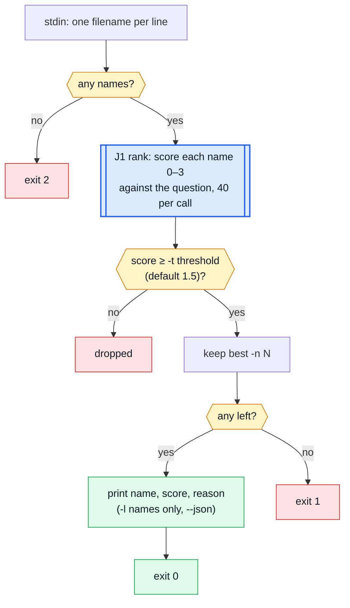

## jevsec

One PDF: read the question, walk the book or compose a table, report.

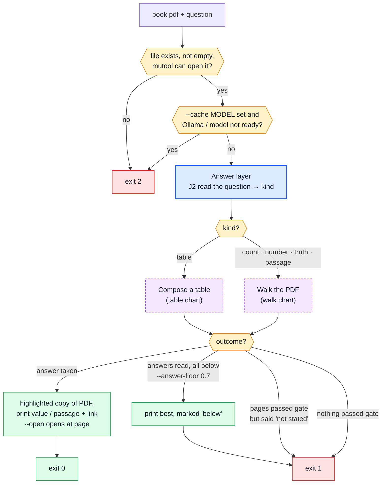

## jevfind: across or one answer

Decides between a table across the shelf and one answer from the best file.

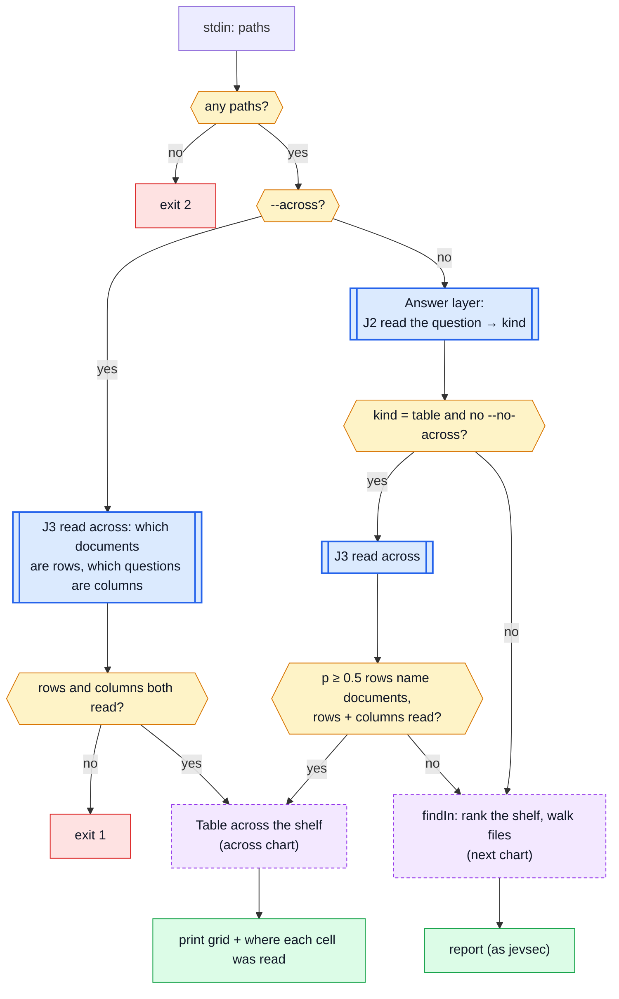

## jevfind: ranking and opening files

`findIn` in shelf.ts: files ranked by name and by pages that mention the subject, then walked best-first.

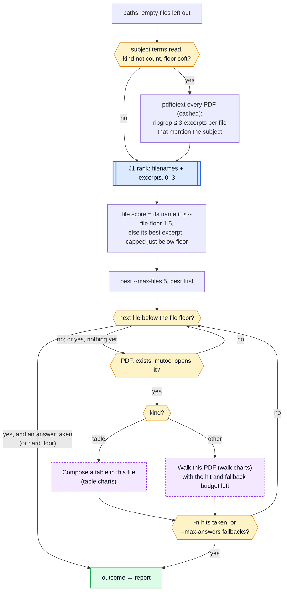

## A table across the shelf

Each cell is a question of its own, read (J2) and walked over the shelf under a hard file floor.

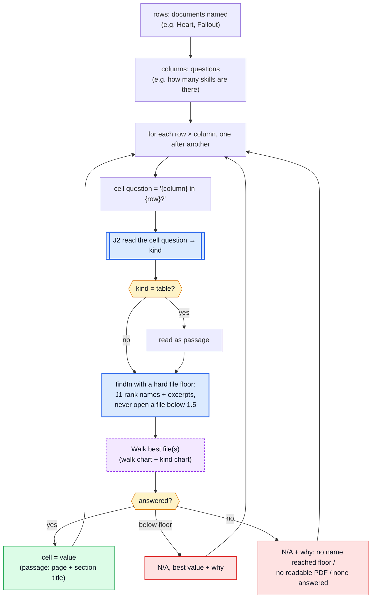

## The answer layer

`answerLayer` in cli.ts. `--kind` replaces only the kind: the quantities, counted kind, subject and game still come from J2.

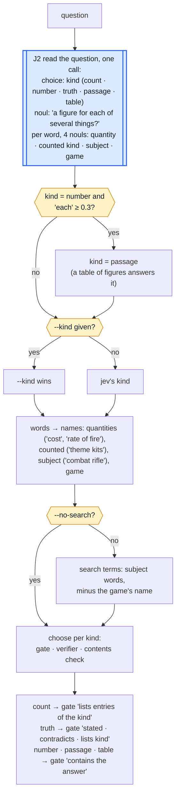

## The walk: contents and ranking

`searchPdf` in pdf.ts, up to the ranked list.

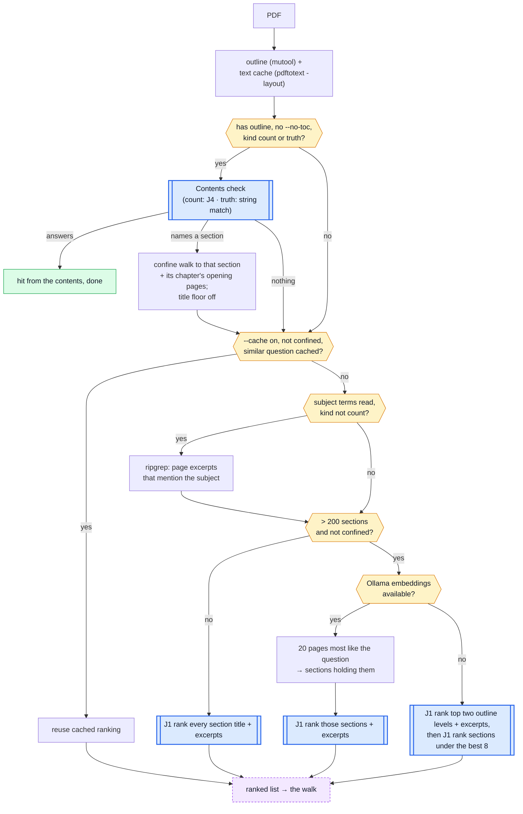

## The walk: gating and settling

Pages gated in ranked order; a page that passes is read by its kind and taken, kept or dropped.

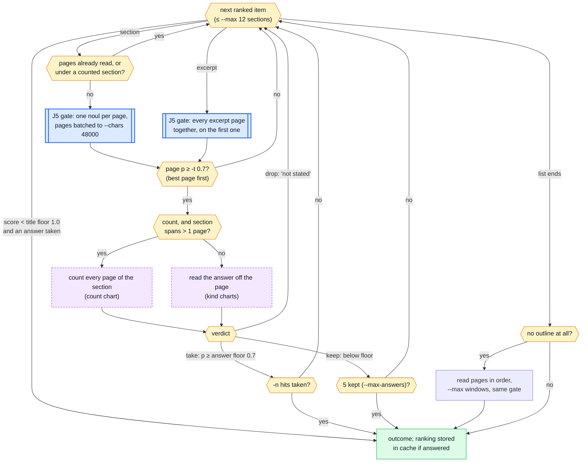

## Count: from the contents

`answerFromOutline` in answer.ts, before any page is read.

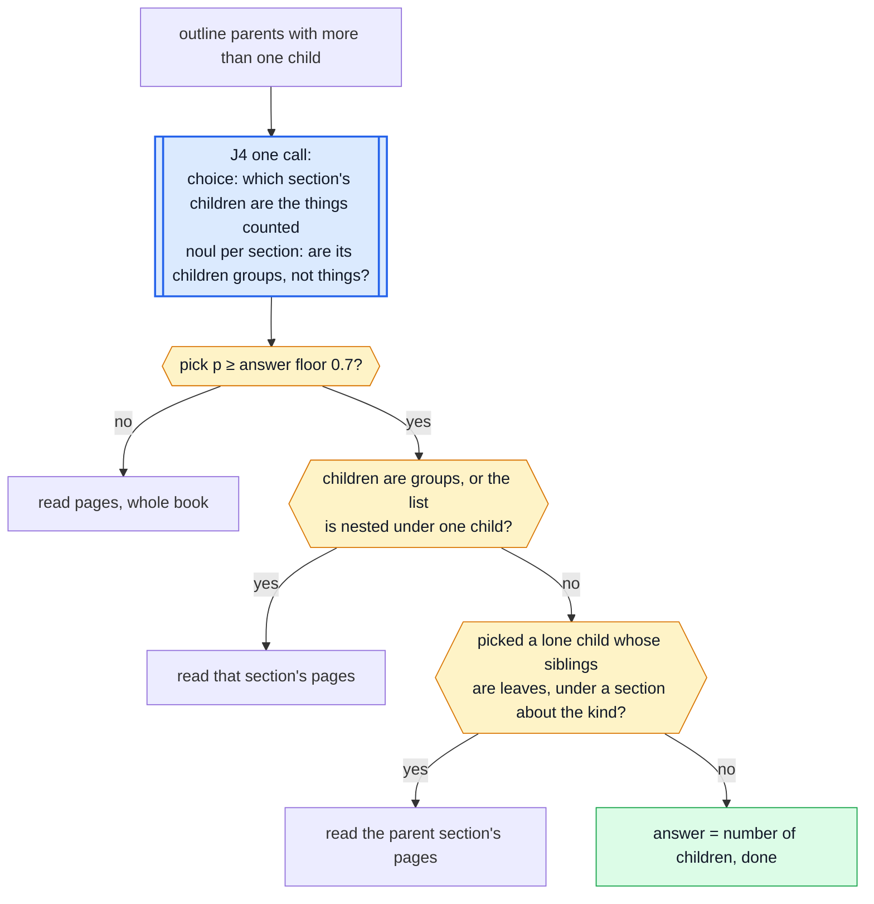

## Count: from the pages

jev judges each candidate name; code counts.

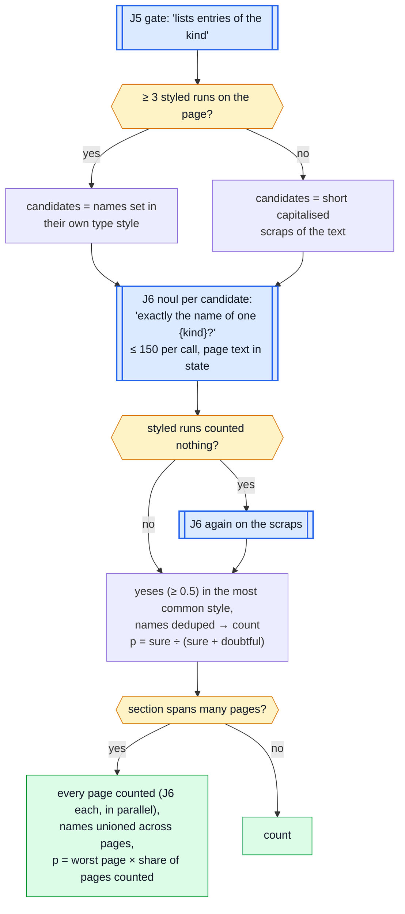

## Number

The answer is one of the figures printed on the page; jev picks which.

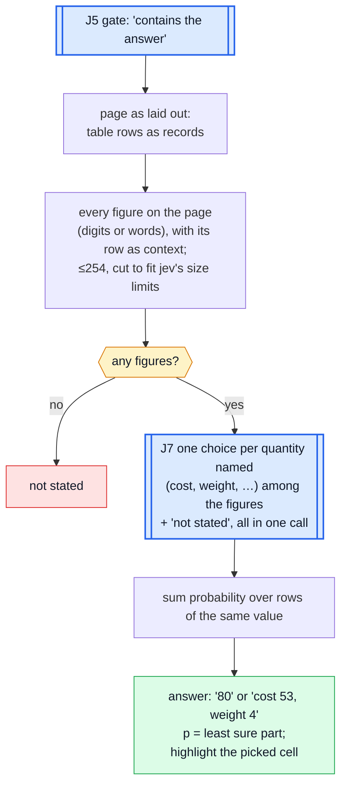

## Truth

The gate's three nouls are the verdict; a false read off a list is checked on the pages either side.

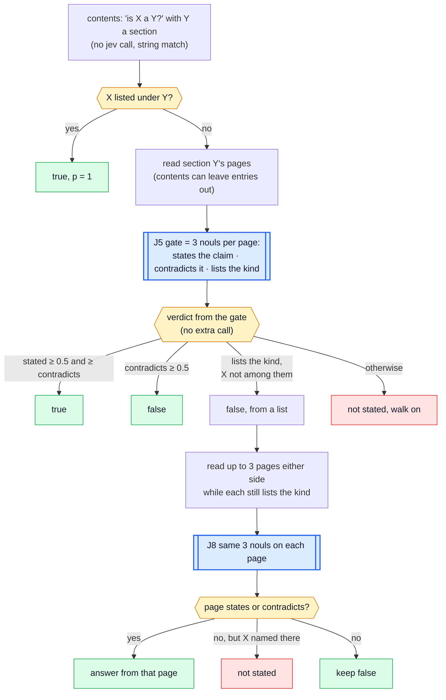

## Passage

One noul per sentence; the best runs are the passage, grown onto later pages while they keep answering.

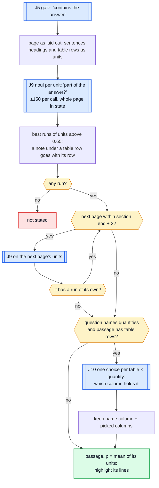

## Table to order: request and rows

`composeTable` in compose.ts.

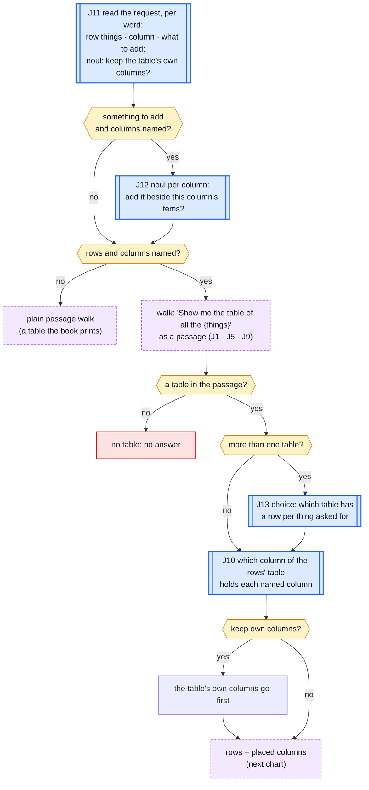

## Table to order: missing columns

A column the rows' table lacks comes from each row's entry, then the row's own cells, then a search of its own.

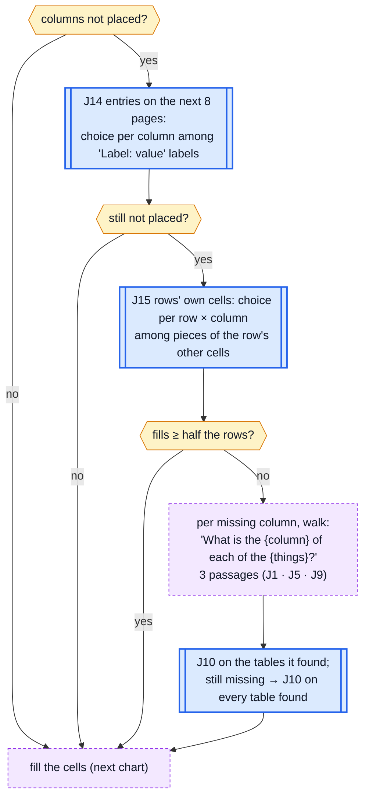

## Table to order: filling the cells

Rows of other tables matched to ours, gaps filled, values added beside items.

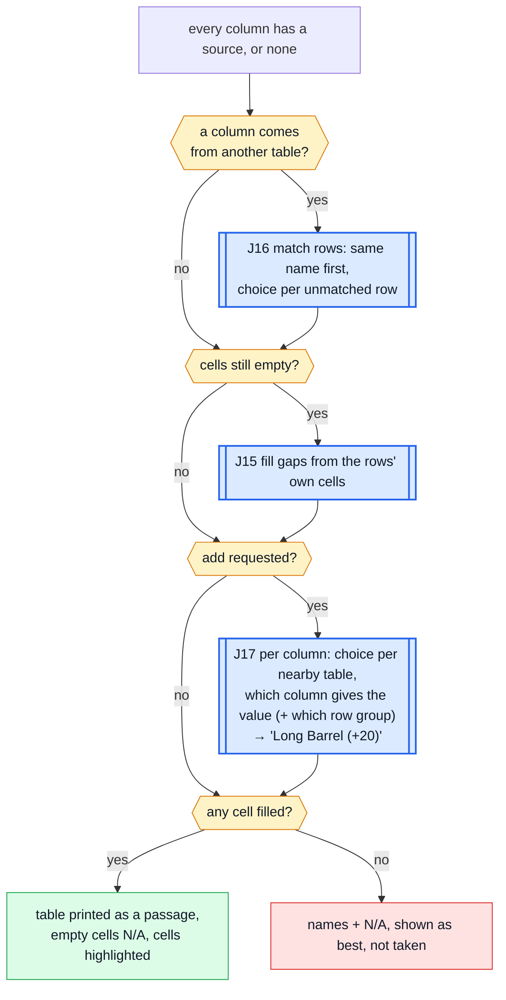
